  

 

## Sobre mí

Estudio 2º de DAM y me oriento al desarrollo full stack, con base en Java, MySQL, HTML y CSS. Soy creadora de contenido tech desde 2020: he aprendido a organizarme con autonomía, a responsabilizarme del resultado final y a mejorar con cada entrega.

|  |  |
|:--|:--|
| `estudia` | 2º DAM en CPR Liceo La Paz (2025 – 2027) |
| `stack` | Java, MySQL, HTML, CSS, Git |
| `busca` | Prácticas (FCT) de backend o full stack |
| `idiomas` | Castellano e inglés B2 (Trinity) |
| `web` | **[isabellanottaro.vercel.app](https://isabellanottaro.vercel.app)** |

 

## Proyectos

Los 3 fijados en mi GitHub.

<table>
<tr>
<td width="33%" valign="top">

### [Portfolio ASCII](https://github.com/nottaroisa/Portfolio)

Mi web: un campo ASCII interactivo que sigue al ratón.

`Next.js` `TypeScript` `Canvas 2D`

**[Verlo en vivo ↗](https://isabellanottaro.vercel.app)**

</td>
<td width="33%" valign="top">

### [FoodDeliveryJava](https://github.com/nottaroisa/FoodDeliveryJava)

Modelo de una app de pedidos y reparto, con su diagrama de clases.

`Java` `POO` `UML` `Git`

**[Ver el código ↗](https://github.com/nottaroisa/FoodDeliveryJava)**

</td>
<td width="33%" valign="top">

### [Moodboard SrtaJeans](https://github.com/nottaroisa/Moodboard)

Moodboard personal, responsive, maquetado con CSS Grid.

`HTML5` `CSS Grid` `Flexbox`

**[Ver el código ↗](https://github.com/nottaroisa/Moodboard)**

</td>
</tr>
</table>

 

## Lo que he visto en DAM

Lo que trabajo en clase, módulo a módulo, hasta 2º.

**Programación** · 1º 

**Bases de datos** · 1º 

**Lenguajes de marcas** · 1º 

**Entornos de desarrollo** · 1º 

**Sistemas informáticos** · 1º 

**Acceso a datos** · 2º 

**Programación de servicios y procesos** · 2º 

**Interfaces y móvil** · 2º 

**Sistemas de gestión empresarial** · 2º 

 

## Creo contenido

**TikTok [@SrtaJeans](https://www.tiktok.com/@SrtaJeans) desde 2020** · 137,4 mil seguidores · 3,4 M de me gusta · 240 vídeos

Hago vídeos de tecnología: móviles, tablets, periféricos y trucos para el ordenador. Busco el tema, escribo el guion, lo produzco y lo publico yo, de principio a fin.

He colaborado con Xiaomi, Huawei, Telefónica, PcComponentes, AliExpress, Temu, Lewitt y Eneryeti.

 

## Comunidades

Donde aprendo fuera del aula.

- **WordPress** · WordCamp y meetups de [WP Coruña](https://wpcoruña.com), traducciones y contribuciones. Lo cuento en [mi blog](https://blogisabellanottaro.blog/).
- **GPUL** · Charlas del [Grupo de Programadores e Usuarios de Linux](https://gpul.org), que promueve el software libre en A Coruña.

 

## Contacto

Respondo antes al correo que a los mensajes directos: **[isabellanottaro@gmail.com](mailto:isabellanottaro@gmail.com)**

